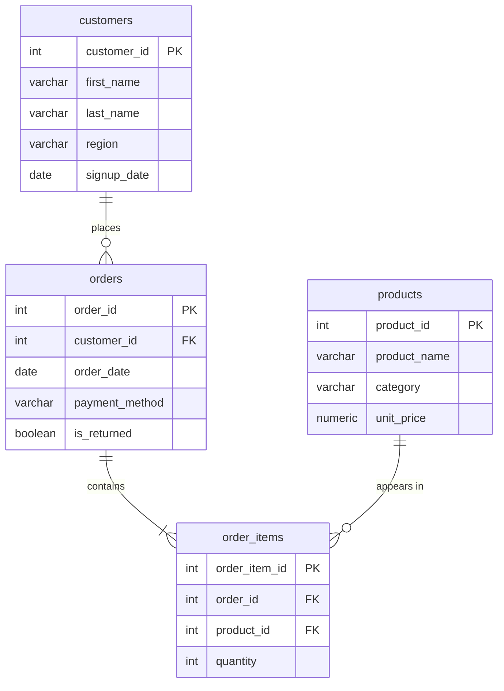

# E-Commerce PostgreSQL Database: Design & Administration

A PostgreSQL project covering core database administration tasks: schema design with data integrity rules, bulk data loading, performance tuning with indexes, role-based access control, and verified backup and restore.

Built on the e-commerce dataset from my [SQL analysis project](https://github.com/Pdhruv1512/ecommerce-sql-analysis), scaled to over 1 million rows for performance testing.

**Tools:** PostgreSQL 18 · psql · Bash · Git

---

## Results at a Glance

| Area | What I did | Result |
|---|---|---|
| Data integrity | Primary keys, foreign keys, NOT NULL and CHECK constraints | Invalid data is rejected automatically |
| Performance | Indexed foreign key columns, measured with `EXPLAIN ANALYZE` | Lookup time **33.6 ms → 1.2 ms (~27x faster)** |
| Security | Least-privilege roles for analysts and applications | Unauthorized deletes and edits are blocked |
| Recovery | Automated backup and restore scripts | Restore verified: **1,004,183 of 1,004,183 rows** recovered |

---

## Database Schema



**Integrity rules:**
- Every order must belong to an existing customer, and every order item to an existing order and product (foreign keys)
- Prices cannot be negative, and quantities must be greater than zero (CHECK constraints)
- Money is stored as `NUMERIC(10,2)` to avoid floating-point rounding errors

---

## 1. Performance: Indexing

PostgreSQL automatically indexes primary keys, **but not foreign keys**. I added 1 million test rows to `order_items`, then measured a lookup by `order_id` before and after indexing.

```sql
EXPLAIN ANALYZE SELECT * FROM order_items WHERE order_id = 500;
```

| | Without index | With index |
|---|---|---|
| Scan type | Parallel Seq Scan | Bitmap Index Scan |
| Rows examined | ~1,000,000 | 635 |
| Data pages read | 5,429 | 595 |
| **Execution time** | **33.6 ms** | **1.2 ms** |

Timings are the steady-state result after repeated runs; the first run was slower (146 ms) because data was not yet cached in memory.

---

## 2. Security: Role-Based Access Control

Following the principle of least privilege, each role gets only the access it needs:

| Role | Permissions | Blocked from |
|---|---|---|
| `analyst_role` | Read all tables | Inserting, updating, deleting |
| `app_role` | Read all tables; insert and update orders | Deleting anything; changing customers or products |

Login users (`analyst_user`, `app_user`) inherit permissions from these roles. Tested by logging in as each user:

```
analyst_user: DELETE FROM customers ...  →  ERROR: permission denied for table customers
app_user:     DELETE FROM orders ...     →  ERROR: permission denied for table orders
```

*Passwords in `05_roles.sql` are placeholders for local use only; real credentials should never be committed.*

---

## 3. Recovery: Backup & Restore

- `scripts/backup.sh` creates a compressed, timestamped backup with `pg_dump` (custom format)
- `scripts/restore.sh` restores a backup into a **separate** database, so it can be verified without touching production

Verification: the restored database matched the original exactly (1,004,183 rows, all 7 indexes).

Note: `pg_dump` backs up a single database but not server-level roles; those would require `pg_dumpall --globals-only`.

Backup files are excluded from Git via `.gitignore`, since in a real system they would contain sensitive customer data.

---

## Project Structure

```
├── data/                 # Source CSV files
├── sql/
│   ├── 01_schema.sql     # Tables, keys, and constraints
│   ├── 02_load_data.sql  # Loads CSVs in dependency order
│   ├── 03_scale_data.sql # Adds 1M test rows for performance testing
│   ├── 04_indexes.sql    # Foreign key indexes
│   └── 05_roles.sql      # Roles and permissions
├── scripts/
│   ├── backup.sh         # Timestamped backup
│   └── restore.sh        # Restore into a test database
└── README.md
```

---

## How to Run

Requires PostgreSQL ([Postgres.app](https://postgresapp.com) on Mac).

```bash
createdb ecommerce
psql ecommerce -f sql/01_schema.sql
psql ecommerce -f sql/02_load_data.sql
psql ecommerce -f sql/03_scale_data.sql   # optional: adds 1M test rows
psql ecommerce -f sql/04_indexes.sql
psql ecommerce -f sql/05_roles.sql

chmod +x scripts/*.sh
./scripts/backup.sh
./scripts/restore.sh backups/<backup-file>.dump
```

---

## What I Learned

- Designing the schema around the **real data**: my first draft didn't match the CSV columns, which would have broken the data load
- Load order matters: foreign keys reject child rows if the parent table isn't loaded first
- Always measure performance changes instead of assuming; caching alone made the same query 4x faster between runs
- A backup isn't proven until it has been restored and verified